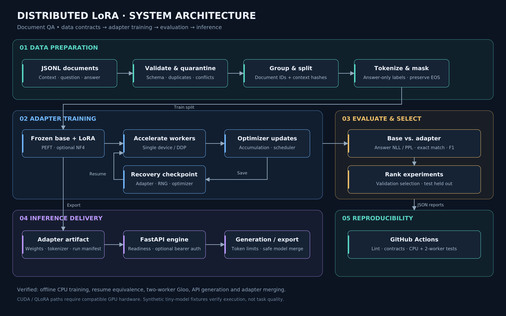

# Distributed LLM Fine-Tuning with LoRA

An end-to-end document question-answering pipeline: validate JSONL data, create document-disjoint splits, train low-rank adapters, compare held-out results, and serve inference through FastAPI. Built with PyTorch, Transformers, PEFT and Accelerate.



## Pipeline

- **Data engineering:** schema validation, duplicate and conflicting-answer quarantine, document/context grouping, seeded splits and SHA-256 provenance.
- **Training:** answer-only supervision, context-aware truncation, frozen base weights, configurable LoRA ranks, gradient accumulation and checkpointing, DDP and optional NF4 QLoRA.
- **Recovery:** optimizer, scheduler, RNG and data-position checkpoints; resume contracts reject incompatible datasets or training settings.
- **Evaluation:** token-weighted negative log likelihood and perplexity, normalized exact match and token F1, base-versus-adapter predictions, and validation-only rank experiments.
- **Inference:** adapter loading, safe merged-model export, bounded generation requests, optional bearer authentication and readiness checks.
- **Automation:** offline integration fixtures, two-worker distributed checks and GitHub Actions report artifacts.

## Run the complete CPU workflow

Requires Python 3.10–3.12. The included model is a small, randomly initialized GPT-2 fixture, so the workflow runs without a model download or GPU.

```bash
python -m venv .venv
source .venv/bin/activate
pip install torch==2.5.1 --index-url https://download.pytorch.org/whl/cpu
pip install -r requirements-dev.txt
make prepare
make smoke
make distributed
make test
```

`make smoke` trains an adapter, interrupts and resumes training, compares it with an uninterrupted run, evaluates unseen documents, calls the real inference API and checks merged-model equivalence. It refreshes `reports/smoke_cpu.json` and the tiny model fixtures. `make distributed` runs two actual CPU/Gloo workers and checks adapter agreement and checkpoint export.

For the exact recorded CPU environment, install `requirements-lock-cpu.txt` with the PyTorch CPU index available as an additional index. CUDA installations should use a hardware-compatible PyTorch build and `requirements-gpu.txt` instead.

## Prepare your dataset

One JSON object per line:

```json
{"document_id":"guide-001","context":"Adapters update a small set of parameters.","question":"What is updated?","answer":"A small set of parameters."}
```

```bash
python -m src.prepare --input examples/document_qa.jsonl --output data/processed
```

Outputs include `train.jsonl`, `validation.jsonl`, `test.jsonl`, `quarantine.jsonl` and a checksummed manifest. Documents sharing an ID **or** normalized context stay together. The included 24-document synthetic dataset produces 16/4/4 records across the three splits.

## Train on your hardware

The launch script defaults to `Qwen/Qwen2.5-0.5B`; the model is downloaded on first use. Configure target modules for your chosen architecture.

```bash
pip install -r requirements-gpu.txt
bash scripts/run_train.sh

# Two CUDA devices, DDP and bf16
ACCELERATE_CONFIG=configs/accelerate_config.yaml bash scripts/run_train.sh
```

`configs/lora_config.yaml` enables NF4, double quantization and attention adapters. Quantized loading requires compatible CUDA/bitsandbytes; unsupported hardware fails with a clear error. Single-process and DDP paths are implemented; CPU single-process and two-worker DDP are verified. CUDA quantization and multi-GPU performance have not been measured in the included reports.

Resume a run with the same model, data, world size and training plan:

```bash
bash scripts/run_train.sh --resume_from runs/document-lora/checkpoint-100
```

Run metadata, validation metrics, parameter counts and checkpoint state are saved under the selected output directory.

## Evaluate and compare

```bash
python -m src.evaluate \
  --base_model examples/artifacts/tiny/base \
  --adapter_dir examples/artifacts/tiny/adapter \
  --train_file data/processed/train.jsonl \
  --validation_file data/processed/validation.jsonl \
  --test_file data/processed/test.jsonl \
  --output runs/evaluation.json

# Compare ranks using validation data; keep test data untouched
make sweep
```

Evaluation refuses document overlap between test and development splits. Each result includes predictions and source-file fingerprints.

## Serve or export

```bash
export LORA_BASE_MODEL=examples/artifacts/tiny/base
export LORA_ADAPTER_DIR=examples/artifacts/tiny/adapter
export LORA_API_KEY=replace-with-your-own-key
python -m uvicorn src.api:app --host 0.0.0.0 --port 8000
```

Set `INFERENCE_URL` to your running service address, then send a request:

```bash
curl "$INFERENCE_URL/generate" \
  -H "Authorization: Bearer $LORA_API_KEY" \
  -H 'Content-Type: application/json' \
  --data @docs/api-request.json
```

`GET /health` reports readiness. `POST /generate` returns answer text, token counts and latency. Leaving `LORA_API_KEY` unset disables authentication. Replace the tiny fixture with a trained pretrained-model adapter for meaningful answers.

```bash
python -m src.inference \
  --base_model examples/artifacts/tiny/base \
  --adapter_dir examples/artifacts/tiny/adapter \
  --merge_and_save merged_model
```

A non-root CPU inference Dockerfile is included: `docker build -t document-lora .`. Supply model paths and API credentials when deploying a trained model. The repository does not provision a public inference endpoint.

## Recorded verification

Measured on the included random CPU fixture; these numbers verify pipeline behavior rather than language-model quality.

| Check | Recorded result |
|---|---:|
| Trainable / total parameters | 1,536 / 95,040 (1.62%) |
| Resumed vs. uninterrupted adapter difference | 0.0 |
| Adapter reload maximum logit difference | 0.0 |
| Merged model maximum logit difference | 1.79 × 10⁻⁷ |
| Distributed workers / optimizer updates | 2 / 4 |
| Distributed adapter agreement | Passed |
| Held-out answer exact match / token F1 | 0.0 / 0.0 |

Full results: [CPU integration](reports/smoke_cpu.json), [distributed execution](reports/distributed_cpu.json), and [rank experiment](reports/rank_sweep_cpu.json). The random fixture is an executable integration asset, not a trained document-QA model.

## Project layout

```text
src/          data preparation, training, evaluation, inference and API
configs/      LoRA and single/distributed Accelerate settings
scripts/      launchers, offline integration checks and rank experiments
examples/     synthetic QA data and compact runnable model fixtures
reports/      measured CPU execution results
tests/       data, masking, metric, model and HTTP contracts
docs/        architecture and API request example
archive/     original project ZIP
```

See [architecture and execution contracts](docs/architecture.md) and [dataset and model notes](docs/model-card.md). MIT license.
